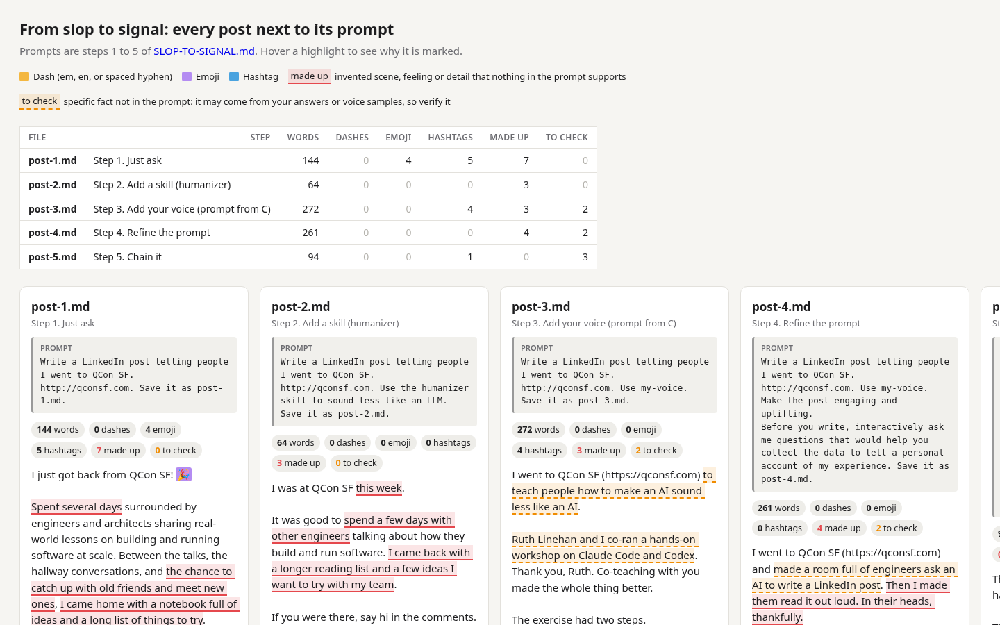
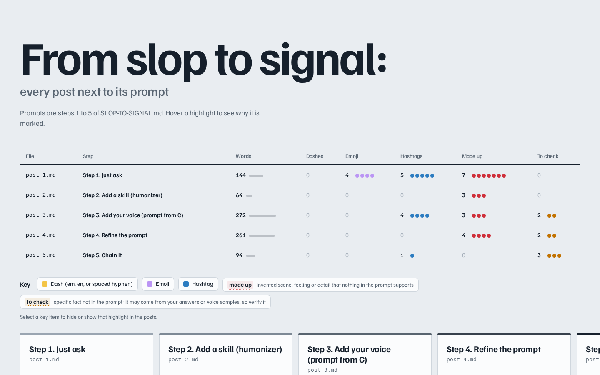
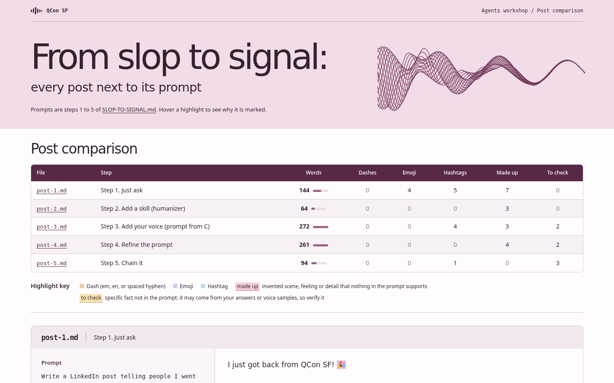
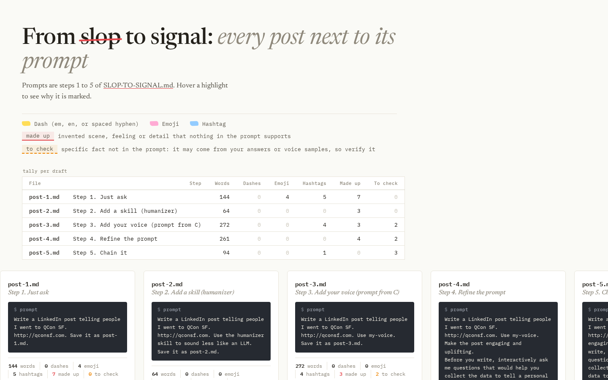

# Exercise: compare and design

This is step 9 of [Slop to signal](SLOP-TO-SIGNAL.md) and its
[Slack track](SLACK.md). First build one page that shows every version
next to the prompt that made it, then redesign that page with a skill.

Agents have a default look for web pages, the same way they have a default
voice for prose. frontend-design is a skill from Anthropic's official
plugin marketplace that steers the agent away from it.

## 1. See them side by side

Have the agent build a page that puts every version next to the prompt
that made it:

> Build compare.html, one page that shows every post-*.md in this folder
> side by side with the prompt that made it, and brief.md at the top. The
> prompts are in exercises/SLOP-TO-SIGNAL.md, and post-final.md is my
> own edit. Show the word count, and highlight dashes, emoji, hashtags,
> and anything that isn't in brief.md. Open it in my browser.

On the Slack track, swap in `msg-*.md`, `msg-final.md`, and
`exercises/SLACK.md`.

Have both Claude Code and Codex? Run steps 1, 4, and 5 in the other one
too, reusing your brief.md. Save them as `codex-post-1.md` and so on,
and ask for both on the page. No second tool? Compare your own.

Which step changed the post most? What did each one cost you, in time or
in answers you had to give? Here is every step on six models, for the
[LinkedIn track](https://ksh-public.s3.us-west-2.amazonaws.com/pages/qconsf-samples/index.html#linkedin)
and the
[Slack track](https://ksh-public.s3.us-west-2.amazonaws.com/pages/qconsf-samples/index.html#slack).

Skipped the earlier steps?
[See our compare.html live](https://ksh-public.s3.us-west-2.amazonaws.com/pages/qconsf-samples/design/before.html).
To redesign it in part 3, the agent needs a copy in your folder:

```
curl -O https://raw.githubusercontent.com/ksmotiv8/qconsf-2026-agents-workshop/main/exercises/design/compare.html
```

## 2. Install frontend-design

Pick the tool you are using.

### Claude Code

In a session:

```
/plugin install frontend-design@claude-plugins-official
```

Choose a scope when it asks. "Install for you, in this repo only" is fine
for the workshop. Or install from your shell:

```
claude plugin install frontend-design@claude-plugins-official --scope local
```

Check it: type `/` in a session and look for `/frontend-design:frontend-design`.

Docs: [Install plugins](https://code.claude.com/docs/en/discover-plugins),
[Plugins](https://code.claude.com/docs/en/plugins),
[Skills](https://code.claude.com/docs/en/skills).

### Codex

Codex reads Anthropic's marketplace too. From your shell, add the
marketplace once, then the plugin:

```
codex plugin marketplace add anthropics/claude-plugins-official
codex plugin add frontend-design@claude-plugins-official
```

Check it: run `/plugins` in a new session, or `codex plugin list`.

Docs: [Plugins](https://learn.chatgpt.com/docs/plugins),
[Skills](https://learn.chatgpt.com/docs/build-skills),
[CLI reference](https://developers.openai.com/codex/cli/reference).

### mo

mo has no plugins yet, but it reads skill folders. Ask it to copy the skill
in:

> Install the frontend-design skill from
> https://github.com/anthropics/claude-plugins-official/tree/main/plugins/frontend-design
> in this project.

Check it: start a new mo session and run `/skill`. frontend-design should
be in the list. mo reads skills from `.mo/skills/`, `.claude/skills/` and
`.agents/skills/`, in the project or in your home folder.

Docs: [MOMENTO.md](MOMENTO.md).

## 3. Redesign the page

Start a new session in the same folder, so the skill loads, then:

> Use the frontend-design skill to redesign compare.html. Keep the
> content. Save it as compare-2.html.

## 4. Compare

Open `compare-2.html` next to `compare.html`.

- What changed: type, color, layout, how the data is shown?
- Did it keep every post and every highlight? A prettier page that drops
  content is a regression.
- Anything broken: stray characters, overlapping text, a layout that falls
  apart on a narrow window?

If you have more than one tool, run part 3 in each and put the pages side
by side.

## Bonus: render your benchmark

Did the [Rust Valkey module](VALKEY-MODULE.md) exercise? Turn its
benchmark into a page, from the same folder:

> Read work/valkey-two-sum/bench.md and build bench.html:
> each approach you timed, for each list size and match case, on a log
> scale. Label the axes and units, and mark which one wins each case. Use
> only the numbers that were measured. Open it in my browser.

Then redesign it the same way:

> Use the frontend-design skill to redesign bench.html. Keep every number.
> Save it as bench-2.html.

Does the chart show the same winner as the table for every case? Is the log
scale labeled? Did the redesign keep every number?

## Plugin or skill?

A **skill** is the instructions: a folder with a `SKILL.md` that the agent
reads when the task matches. Claude Code, Codex and mo all read skills.

A **plugin** is the package that ships skills, along with commands, hooks
and MCP servers, from a marketplace with updates. Claude Code and Codex
both install plugins. frontend-design ships as a plugin, but the work is
done by the one skill inside it.

## What we got

We ran this exercise once in each tool, starting from the same
`compare.html`, with the steps above. All three loaded the skill and kept
all five posts. Open the pages to see the full layout and the hover
highlights.

| Tool | Model | Time, install included | Page |
|---|---|---|---|
| Starting page | | | [before.html](https://ksh-public.s3.us-west-2.amazonaws.com/pages/qconsf-samples/design/before.html) |
| Claude Code | Opus 5.5 | 2m 15s | [claude-code.html](https://ksh-public.s3.us-west-2.amazonaws.com/pages/qconsf-samples/design/claude-code.html) |
| Codex | GPT-6.2 Astra, low effort | 1m 13s | [codex.html](https://ksh-public.s3.us-west-2.amazonaws.com/pages/qconsf-samples/design/codex.html) |
| mo | Kimi K3 | 4m 42s | [mo.html](https://ksh-public.s3.us-west-2.amazonaws.com/pages/qconsf-samples/design/mo.html) |

### Starting page



### Claude Code



### Codex



### mo



## Back to the exercise

Return to [Slop to signal](SLOP-TO-SIGNAL.md#done) or the
[Slack track](SLACK.md#done) for the last check before you post.
